<div align="center">

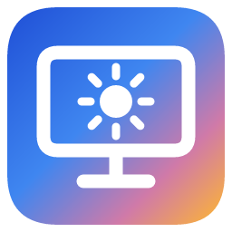

# DisplayForge

### Brightness for every screen, from the tray.

Monitor control for Windows, written in **Rust**.
DisplayForge changes the brightness, contrast, volume and input of external monitors over DDC/CI and the brightness of laptop screens, adds night light and dimming below zero, and can follow a daily schedule or switch to a profile when a chosen app is in front.

<p>
  
  
  
  
</p>

<p>
  
  
  
  
  
  
  
</p>

[**Features**](#-features) ·
[**Screenshots**](#%EF%B8%8F-screenshots) ·
[**Download**](#-download) ·
[**Command line**](#%EF%B8%8F-command-line) ·
[**Build**](#%EF%B8%8F-build-from-source) ·
[**Developer**](#-developer)

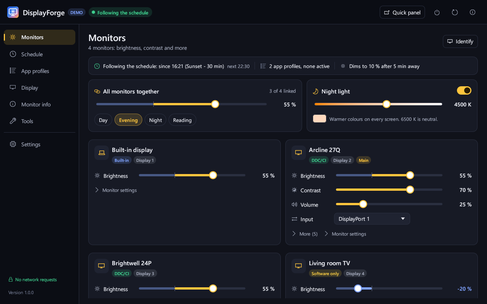

</div>

---

> [!NOTE]
> **First release.** On a real PC it has been run against one laptop with a built-in screen: the screen was found and its brightness read through Windows; nothing was changed on it. External monitors over DDC/CI, night light and dimming (gamma ramp and overlay), the tray panel, hotkeys and changes to resolution, refresh rate, orientation and the main display have so far been tested only against simulated monitors (`--selftest` and 133 unit tests), not on real hardware. Reports from people with DDC/CI monitors are welcome.

## ✨ Features

<table>
<tr>
<td width="50%" valign="top">

### 🔆 Every screen, one place
- A slider per monitor, by name, in a small panel next to the clock
- **Link all**: move every screen together
- Quick presets: **Day**, **Evening**, **Night**, **Reading**, and your own
- Scroll the mouse wheel over the tray icon to change brightness
- Smooth fades, paced so slow monitors are not flooded
- Calibrate each monitor (its own 0 and 100), so different screens look alike

</td>
<td width="50%" valign="top">

### 🖥️ External monitors and laptops
- External monitors over **DDC/CI**: brightness, contrast, volume, input source, power, colour preset and red/green/blue gain, where the monitor supports them
- Laptop screens through Windows (WMI)
- A plain message when a screen does not answer DDC/CI, and what to try
- A read-only list of every setting the monitor reports

</td>
</tr>
<tr>
<td valign="top">

### 🌙 Night light and dimming
- Night light with a colour-temperature slider (1900 to 6500 K)
- **Below zero**: dim past the monitor's minimum, with a gamma ramp or a click-through dark overlay
- Screens without DDC/CI (many TVs) can still be dimmed in software

</td>
<td valign="top">

### ⏰ Schedules and app profiles
- A daily schedule by clock time or **sunrise / sunset** with offsets, with gradual transitions
- Sunrise and sunset are computed on your PC from a city in the built-in list or typed coordinates
- **Per-app profiles**: when a chosen app is in front (or full screen), apply its brightness, contrast and colour temperature; restore afterwards
- Dim when you are away; wake on the first key or mouse move
- Global hotkeys: brightness up/down, presets, night light, turn screens off

</td>
</tr>
<tr>
<td valign="top">

### 🛠️ Display settings and tools
- Resolution, refresh rate, orientation and primary display, with a **15-second keep-or-revert** countdown
- Scaling and HDR status for each display
- Monitor details from the EDID: maker, model, size, native mode, year (serial hidden unless you ask)
- Full-screen **test patterns**: dead pixels, uniformity, gradient banding, colour bars, sharpness
- **Identify** monitors with big numbers, and a picture of the layout

</td>
<td valign="top">

### 🔒 Small and private
- No network requests, no telemetry, no account
- Runs with normal user rights
- Start with Windows (optional), dark and light themes
- Export and import all settings as one file
- One EXE; the C runtime is linked in

</td>
</tr>
</table>

## 🖼️ Screenshots

<table>
<tr>
<td width="50%" align="center"><b>Tray panel</b><br>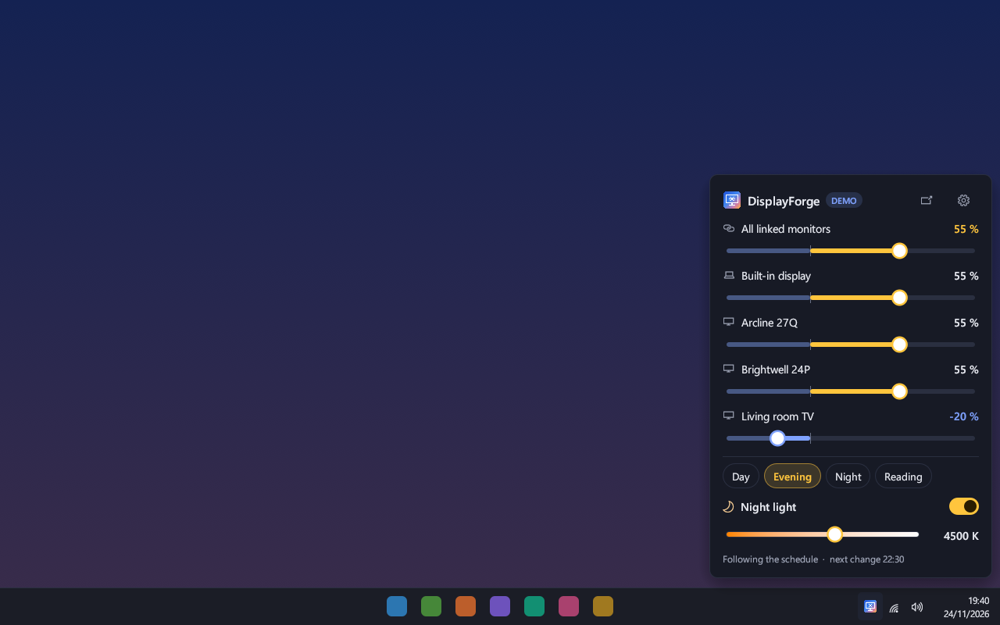</td>
<td width="50%" align="center"><b>Schedule</b><br>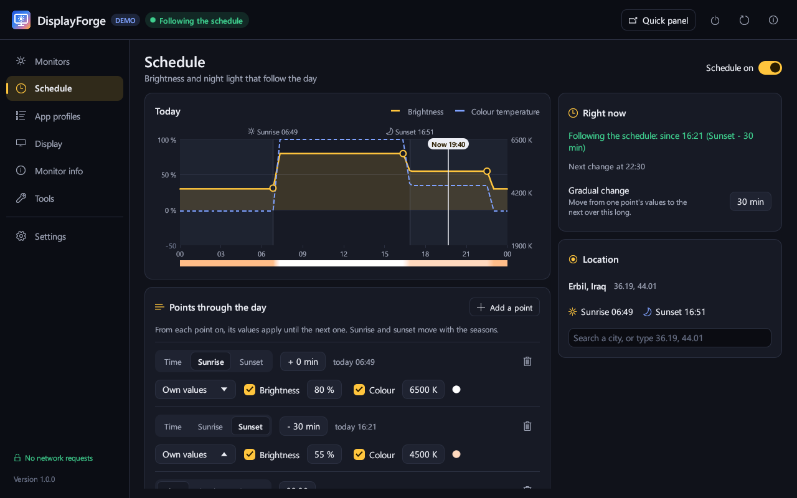</td>
</tr>
<tr>
<td width="50%" align="center"><b>App profiles</b><br>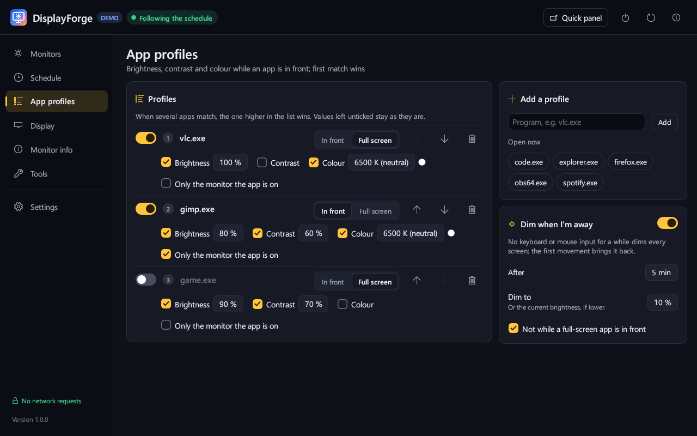</td>
<td width="50%" align="center"><b>Display settings</b><br>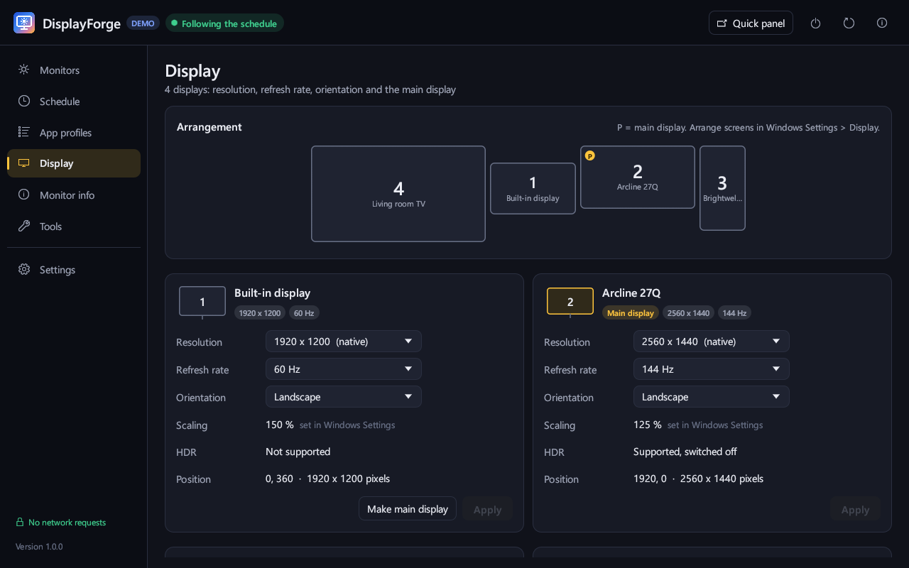</td>
</tr>
<tr>
<td width="50%" align="center"><b>Keep or revert</b><br>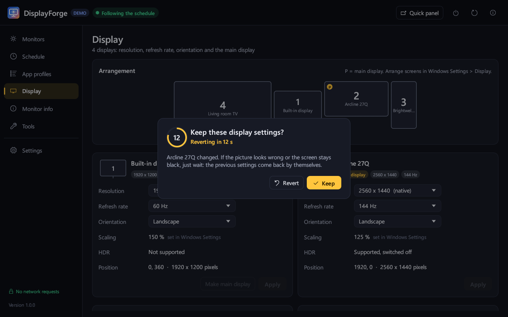</td>
<td width="50%" align="center"><b>Monitor details</b><br>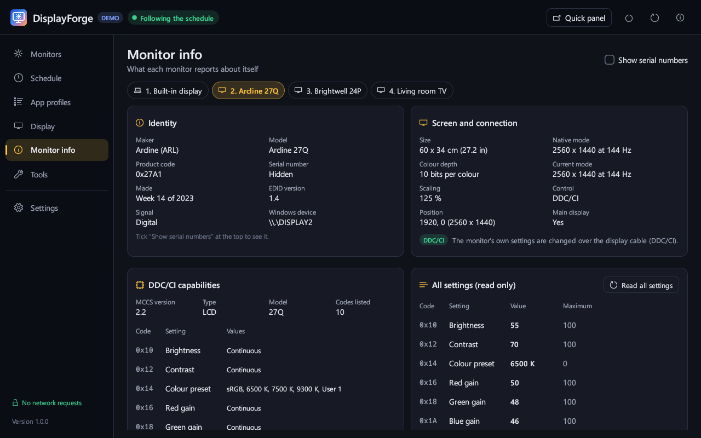</td>
</tr>
<tr>
<td width="50%" align="center"><b>Tools</b><br>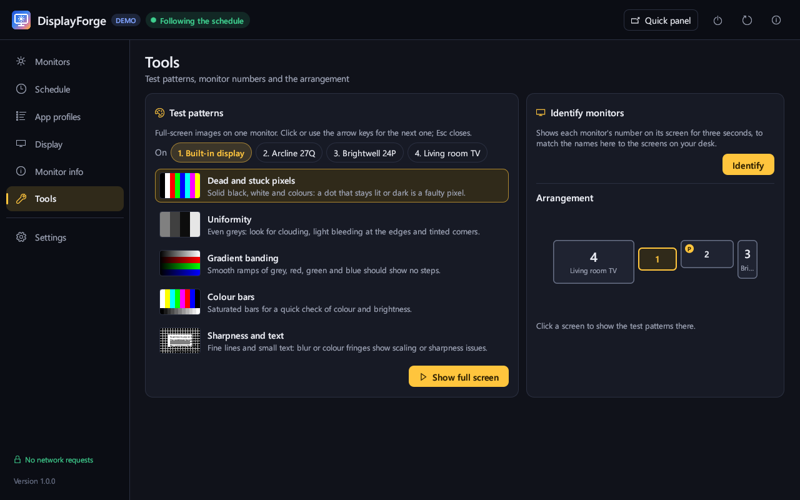</td>
<td width="50%" align="center"><b>Settings</b><br>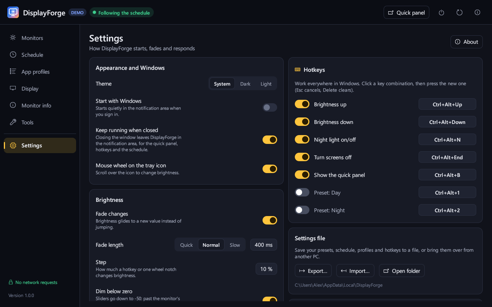</td>
</tr>
<tr>
<td width="50%" align="center"><b>About</b><br>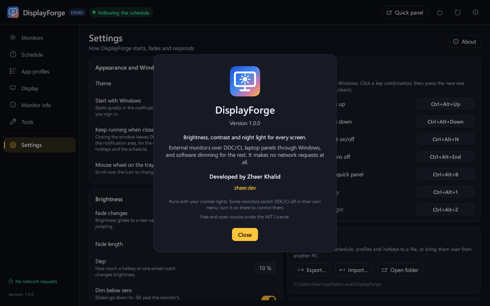</td>
<td width="50%" align="center"><b>Light theme</b><br>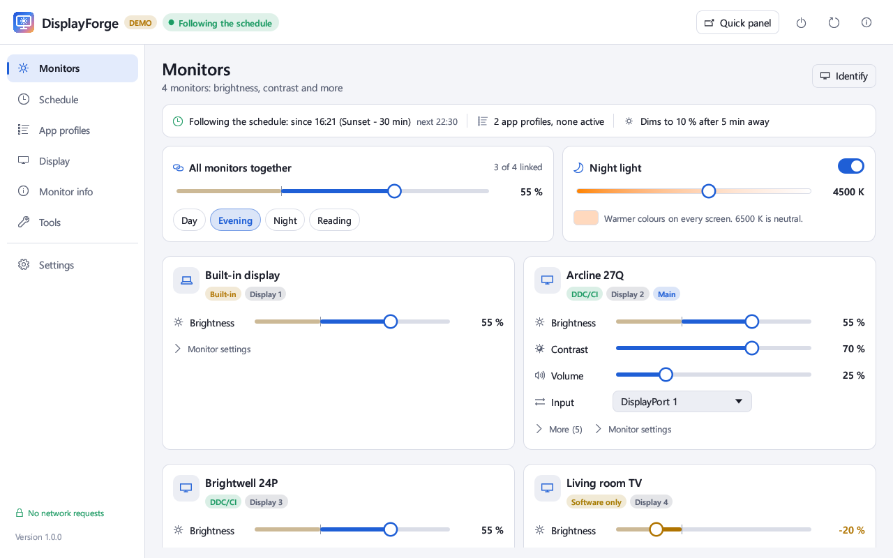</td>
</tr>
</table>

<sub>Screenshots use the built-in demo mode (<code>DisplayForge.exe --demo</code>), with invented monitors.</sub>

## 📥 Download

Get it from the [**latest release**](https://github.com/zheerkhalid/displayforge/releases/latest):

| File | What it is |
|---|---|
| `DisplayForge-Setup.exe` | Installer with shortcuts, an optional start-with-Windows entry and an uninstaller |
| `DisplayForge-x.y.z-portable-x64.zip` | Portable: unzip and run |
| `DisplayForge.exe` | The bare 4.9 MB EXE |

DisplayForge does not need administrator rights. Settings are kept in `%LOCALAPPDATA%\DisplayForge`.

Good to know:

- DDC/CI has to be switched on in many monitors' own menus. Some docks, adapters, KVM switches and most TVs do not pass it through; DisplayForge then offers software dimming instead.
- DDC/CI is slow by design (tens of milliseconds per change). DisplayForge fades in steps the monitor can keep up with.
- Night light and dimming below zero use the display's gamma ramp. Windows limits how far a ramp may be changed, so the warmest settings may be refused on some drivers; Windows' own Night light and other colour tools use the same ramp, so use one at a time. The ramp is reset when DisplayForge exits.
- With HDR on, Windows ignores gamma ramps; monitor brightness over DDC/CI still works.

## ⌨️ Command line

| Command | What it does |
|---|---|
| `DisplayForge.exe --list` | List monitors, how each is controlled and its current values |
| `DisplayForge.exe --brightness 40` | Set every monitor to 40 % |
| `DisplayForge.exe --brightness 40 --monitor 2` | Set only monitor 2 |
| `DisplayForge.exe --preset Night` | Apply a preset |
| `DisplayForge.exe --background` | Start in the notification area only |
| `DisplayForge.exe --quit` | Ask the running DisplayForge to exit |

When DisplayForge is running, `--brightness` and `--preset` are handed to it.

## 🏗️ Build from source

Requires Rust (stable, MSVC toolchain) on Windows.

```powershell
git clone https://github.com/zheerkhalid/displayforge
cd displayforge
cargo build --release
# -> target\release\DisplayForge.exe
cargo test
```

| Command | What it does |
|---|---|
| `DisplayForge.exe --demo` | Invented monitors; nothing on the PC is changed |
| `DisplayForge.exe --screenshot out.png --view schedule [--light]` | Render a page of the demo to a 1280 x 800 PNG |
| `DisplayForge.exe --selftest` | Run the engine against simulated monitors and check the results |
| `scripts\package.ps1` | Build the EXE, the portable ZIP and the installer |

The icon is drawn in code at build time. The C runtime is linked statically, so the EXE runs on a clean Windows install.

## 👨‍💻 Developer

<table>
<tr>
<td align="center" width="140">
  <a href="https://zheer.dev">
    
  </a>
</td>
<td>

**Designed and developed by [Zheer Khalid](https://zheer.dev)**

🌐 Website: **[zheer.dev](https://zheer.dev)**  
🐙 GitHub: **[@zheerkhalid](https://github.com/zheerkhalid)**  
🧩 All the Forge apps in one place: **[ForgeDock](https://github.com/zheerkhalid/forgedock)**

If DisplayForge is useful to you, a ⭐ on the repo is appreciated.

</td>
</tr>
</table>

## 📄 License

MIT © 2026 [Zheer Khalid](https://zheer.dev). See [`LICENSE`](LICENSE).

<div align="center">
<sub>Built with 🦀 Rust and ❤️ by <a href="https://zheer.dev">zheer.dev</a></sub>
</div>
